<p align="center">
  
</p>

<p align="center">
  
  
  
  
  
</p>

<p align="center"><b>A strategy auditor that thinks like a sceptical reviewer.<br>Your file says what to hold. Audition owns the data, the clock, the fills, the costs and the statistics, then grades what's left.</b></p>

---

## What it does

Most backtests flatter the person who wrote them: they peek at the future, trade for free, test a thousand variants and report the best one, or pick a stock list that already knows who survived. Audition takes one Python function, runs it on its own engine and goes looking for exactly those problems.

- **71 checks**, each measured, not asked: lookahead and leakage by re-running on cut-off history, deflated Sharpe against the variants you tried, realistic costs (spreads, impact, stamp duty, borrow), capacity, Monte Carlo, factor attribution and more.
- **A grade, A to F**, capped by the worst problems so one fatal flaw can't hide behind seventy passes.
- **A holdout vault.** The first rehearsal locks the last two years away. Iterate on the rest; every version is counted. Then take the final audition once on the locked years, sealed with a timestamp.
- **Look-alikes and events.** Is your edge just momentum, or an ETF you could buy? How much of it came from FOMC days, CPI or earnings?
- **Paper trading** on your own paper account, tracked against the backtest's own range of outcomes.

## Setup (about a minute)

```bash
git clone https://github.com/RyFinance/audition.git
cd audition
./setup.sh          # local Python env + dependencies (once)
./run.sh            # the app: http://127.0.0.1:8767
```

A fresh clone opens to a shelf with one disc: **the tutorial**, a QQQ dip buyer with three classic mistakes baked in. A guided tour starts on first visit (restart it from Help → Tutorial). Help → Setup shows what's connected; nothing beyond Python and an internet connection is required.

## Using it

The shelf holds one white CD-R per audited strategy. A single pill at the bottom does the navigation: **Audition | ‹ section › | grade**. The middle opens the menu; press `M` anywhere.

| Menu | What it's for |
|---|---|
| **1 · Add a strategy** | Drop or paste a `.py` file, or **translate** a TradingView Pine script, QuantConnect / Backtrader / MQL code, a tweet or a plain-English rule into one (uses your Claude Code login, or `ANTHROPIC_API_KEY`). Rehearsal mode is on by default. |
| **2 · Shelf** | Every audit, as a disc. Click one to open its report. |
| **3 · Paper trading** | Today's targets turned into orders on your paper account, plus live-vs-backtest tracking. |
| **Check a claim** | Paste trades someone posted. Did those prices trade that day (or that 5-minute bar)? Do the returns add up? Are the fills suspiciously perfect? |
| **Price data** | Pick a data source, upload your own CSV / Parquet / Excel / JSON (with a data checker for bad bars, unadjusted splits, gaps and stale prices). |
| **Help** | Setup checklist, how it works, the tutorial. |

Every report reads in five sections, in order: **Verdict** (grade, why, the ten checks that matter) → **Returns** (net performance and Monte Carlo futures) → **Where the edge comes from** (look-alikes and events) → **Out of sample** (holdout years, other markets) → **Evidence** (all 71 checks and how to reproduce the run).

## The strategy file

```python
NAME = "My strategy"
PARAMS = {"lookback": 60, "top_n": 3}       # numbers here get sensitivity-tested
UNIVERSE = ["AAPL", "MSFT", "NVDA"]         # or {"us": [...], "jp": [...]}, "sp500", "byo:<dataset>"
DATA = "yahoo"                              # optional: any source below
DECLARE = {"variants_tried": 10, "oos_start": "2022-01-01", "oos_looks": 1,
           "reported": {"cagr": .25, "sharpe": 1.6, "max_dd": -.18}}

def weights(data, lookback, top_n):          # data.open/high/low/close/volume: dates x tickers
    mom = data.close / data.close.shift(lookback) - 1
    rank = mom.rank(axis=1, ascending=False)
    return (rank <= top_n).astype(float) / top_n   # decided at the close, filled at the next open
```

`UNIVERSE = "sp500"` rebuilds the S&P 500 as it was on every date (from its dated change list, with prices for former members) and passes `data.eligible`, so survivorship is measured instead of assumed. Markets for replays: `us`, `uk`, `eu`, `jp`, `crypto`.

## Data sources

| Source | Key | Notes |
|---|---|---|
| Yahoo Finance | none | Default. Adjusted daily bars back to the 1990s. |
| Binance | none | Crypto daily candles (BTC-USD → BTCUSDT). |
| Polygon.io | yes | Split-adjusted aggregates. |
| Tiingo | yes | Split- and dividend-adjusted EOD back to the 1960s. |
| Alpaca market data | yes | From 2016; IEX feed free. |
| Alpha Vantage | yes | Adjusted daily series. |
| Financial Modeling Prep | yes | US and global EOD. |
| EODHD | yes | 70+ exchanges, Yahoo-style suffixes mapped. |
| Twelve Data | yes | Stocks, ETFs, FX, crypto. |
| Marketstack | yes | 70+ exchanges with adjusted closes. |

Or upload your own files and use `UNIVERSE = "byo:<name>"`. Keys live in `config/connections.json` (mode 600, git-ignored) and never appear in a report.

## Paper brokers

| Broker | Markets | Endpoint |
|---|---|---|
| Alpaca | US stocks & ETFs | paper-api.alpaca.markets, market-on-open |
| Tradier | US stocks & ETFs | sandbox.tradier.com |
| Interactive Brokers | global stocks | your local Client Portal Gateway, paper (`D…`) accounts only |
| OANDA | FX & CFDs | api-fxpractice.oanda.com |
| Binance | crypto | testnet.binance.vision |
| Bybit | crypto | api-testnet.bybit.com |
| Webhook | anything | POSTs signed JSON orders to your own engine |

Every broker integration targets a paper, sandbox, practice or testnet endpoint. **There is no live-trading code in Audition.**

## Command line

```bash
.venv/bin/python -m audition run my_strat.py --rehearsal      # audit, locked years hidden
.venv/bin/python -m audition final my_strat.py                # the final audition (once; --retake is recorded)
.venv/bin/python -m audition translate strategy.pine          # Pine / code / English -> strategy file
.venv/bin/python -m audition claims trades.txt                # check posted trades
.venv/bin/python -m audition callback my_strat.py --broker alpaca_paper --send
.venv/bin/python -m audition serve                            # the app
```

## Safety

- The app listens on **127.0.0.1 only**. Imported strategy files run with full Python permissions on your machine, exactly like `audition run`, so only import code you trust.
- Your audits, vault, paper-trading state, uploads and keys stay in git-ignored folders (`reports/`, `vault/`, `callback/`, `data/`, `config/`).

## Your risk

Audition is research software, not a broker or an adviser, and nothing here is financial advice. A backtest audit can't prove an edge; it can only find reasons to distrust one. A good grade is not a prediction. Paper results are not live results. You are responsible for anything you trade.

## How the checks work

| Concern | How Audition tests it |
|---|---|
| Lookahead | Re-runs on history truncated at many dates; any decision that changes is reading the future |
| Leakage | Replaces prices after a cut with noise; any earlier decision that changes is leaking |
| Multiple testing | Deflated Sharpe against your declared number of variants |
| Significance | Block-bootstrap Sharpe interval, probabilistic Sharpe, shuffled-calendar placebo |
| Costs | Commission, Abdi-Ranaldo spread estimate per asset, UK stamp duty / EU FTT, square-root impact, borrow |
| Capacity | Same strategy at $0.1M to $1B |
| Serial correlation | Lo (2002) adjusted Sharpe and monthly Sharpe |
| Monte Carlo | Stationary block bootstrap vs iid, bear-only resampling, ruin odds |
| Independence | Your reported numbers compared with Audition's own; optional Alpaca cross-check of prices (`APCA_API_KEY_ID`) |
| Survivorship | Point-in-time S&P 500 arm vs your list; per-year price coverage |
| Factors | Weekly Fama-French 5 + momentum regression, Newey-West errors |
| 61-71 | Turnover, cross-market replication, rolling stability, timing luck, start date, universe subsampling, best days, own-universe equal weight, win/loss, drawdown pain, factor attribution |

Markets: `us`, `uk`, `eu`, `jp`, `crypto`. Default universes are today's large caps, so they are
survivors; the survivorship check says so on every run. A backtest audit can't prove an edge,
only find reasons to distrust one.
